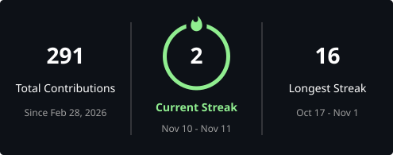

<div align="center">
  
</div>
<div align="center">

# Anmol Gupta

**Full-Stack AI Engineer · Backend · Generative AI · Agentic Systems**

Building practical software powered by AI, APIs, and open-source tools.

[GitHub](https://github.com/AnmolCanCodes) · [LinkedIn](https://www.linkedin.com/in/anmol-gupta-fr) · [X](https://x.com/Stateful_Anmol) · [LeetCode](https://leetcode.com/CodessWAnmol) · [Email](mailto:anmol221105@gmail.com)

</div>

---

## About Me

```json
{
  "name": "Anmol Gupta",
  "role": "Full-Stack AI Engineer",
  "focus": [
    "Backend Engineering",
    "Generative AI",
    "RAG & Agentic Systems",
    "Full-Stack Development"
  ],
  "experience": [
    "Independent Software Development",
    "Hacktoberfest 2026 Participant"
  ],
  "currently_building": [
    "AI-powered applications",
    "Developer tools",
    "Practical AI products"
  ],
  "open_to": [
    "Software Engineering Opportunities",
    "AI Application Development",
    "Freelance Projects",
    "Open-Source Collaboration"
  ]
}
```

## Experience

**Independent Full-Stack AI Engineer** · Remote

- Build end-to-end applications across frontend, backend, databases, and AI integrations.
- Develop LLM-powered applications using RAG, LangChain, and LangGraph.
- Work with Python, FastAPI, React, TypeScript, and relational databases.

**Hacktoberfest 2026** · Participant

- Built AI-powered software projects during themed development challenges.
- Explored open-weight models, open-source frameworks, and AI API integrations.
- Practiced rapid prototyping and turning ideas into working application demos.

## Featured Projects

| Project | Description | Status |
|---|---|---|
| [AI Customer Support Copilot](https://github.com/AnmolCanCodes/AI-Customer-Support-Copilot) · [Live Demo](https://ai-customer-support-copilot-silk.vercel.app) | RAG-powered support assistant for context-aware customer responses. | Demo available |
| [AI Repo Intelligence Agent](https://github.com/AnmolCanCodes/AI-Repo-Intelligence-Agent) · [Live Demo](https://ai-repo-intelligence-agent.vercel.app) | Ask questions about a codebase using retrieval and a LangGraph-based workflow. | Demo available |
| [PriceZen](https://github.com/AnmolCanCodes/pricezen-frontend) · [Live Website](https://pricezen.in/) | Competitor price monitoring for e-commerce businesses. | Website live |
| [SnapRecall](https://github.com/AnmolCanCodes/snaprecall) | AI-powered project currently under development. | In progress |
| [AI Tender & RFQ Agent](https://github.com/AnmolCanCodes/Ai_Tender_RFQ_agent) | AI project focused on tender and request-for-quotation workflows. | In progress |

## Tech Stack

**Languages**


**Frontend Development**


**Backend & Databases**


**Generative AI & Agentic Systems**


**Data Science & Machine Learning**


*Core Skills:* Exploratory Data Analysis (EDA) · Data Preprocessing · Feature Engineering · Data Visualization · Machine Learning Fundamentals · Model Evaluation

**Tools & Deployment**


## GitHub Stats

<div align="center">

  

  

  <br />

  

</div>

### Contribution Activity

<div align="center">
  <picture>
    <source media="(prefers-color-scheme: dark)" srcset="https://raw.githubusercontent.com/AnmolCanCodes/AnmolCanCodes/output/pacman-contribution-graph-dark.svg">
    <source media="(prefers-color-scheme: light)" srcset="https://raw.githubusercontent.com/AnmolCanCodes/AnmolCanCodes/output/pacman-contribution-graph.svg">
    
  </picture>
</div>

---

<div align="center">

*Building useful software, one project at a time.*


</div>
